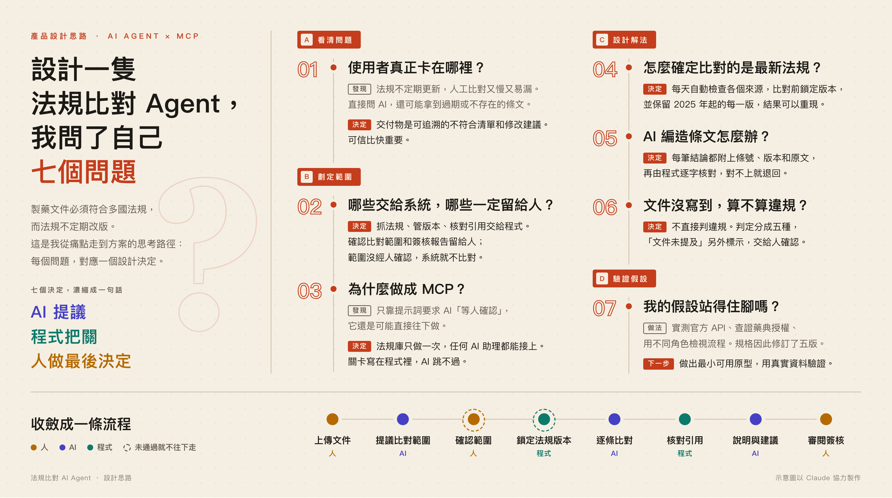
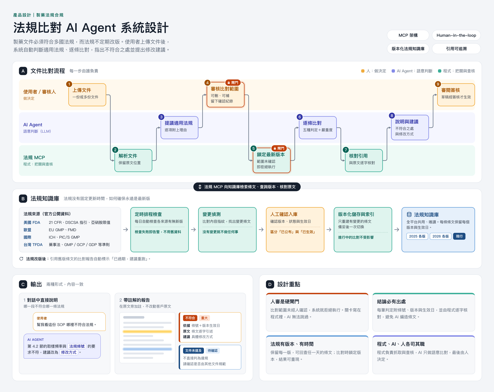

[繁體中文](README.md) | English

# pharma-regulatory: a regulation lookup MCP server

Lets an AI assistant look up pharmaceutical regulations that are **official, current and cited** — instead of answering from memory.

<sub>v0.1 prototype · Python 3.10+ · MCP (Model Context Protocol)</sub>



*The diagram is in Traditional Chinese. In short, it walks through seven questions behind the design of a regulatory-comparison agent, each answered with a decision:*

1. *Where do users actually get stuck? Regulations change without notice, manual comparison is slow and easy to get wrong, and asking an AI directly can return outdated or non-existent clauses. So the deliverable is a traceable list of gaps with suggested fixes — trust matters more than speed.*
2. *What goes to the system and what stays with people? Code fetches regulations, manages versions and verifies citations. People confirm the comparison scope and sign off the report. No confirmed scope, no comparison.*
3. *Why MCP? Telling an AI in a prompt to "wait for confirmation" is not reliable. Build the regulation library once so any assistant can plug in, and put the gates in code where the AI cannot skip them.*
4. *How do we know we are comparing against the latest regulation? Check every source daily, lock the version before comparing, and keep every version from 2025 onward so results are reproducible.*
5. *What if the AI makes up a clause? Every finding carries the clause number, version and original text, and code checks the quote word for word.*
6. *If the document does not mention something, is that a violation? Not automatically. There are five verdict types, and "not mentioned" is flagged separately for a person to check.*
7. *Do these assumptions hold? The official APIs were tested, licensing was checked, and the flow was reviewed from several roles. Next step: a minimal prototype validated with real data — this repository.*

*The strip at the bottom shows the resulting flow, summed up as: **AI proposes, code gates, people decide.***

---

## Why this exists

Before a pharmaceutical document goes out, someone has to confirm it meets the latest regulations in every relevant country. Three things make that hard:

1. **Regulations change without a schedule.** It is difficult to be sure the copy you have is the current one.
2. **Comparing clause by clause by hand is slow and easy to get wrong.** One document often has to be checked against several countries' rules.
3. **Asking an AI directly can return clauses that are outdated or do not exist.** A model's memory stops at its training date, and it can make a clause number sound entirely plausible.

The full answer is a regulatory-comparison agent (see the diagram above and the system design below). **v0.1 solves the bottom layer first: lookups that are real, versioned and cited.**

- **Real**: clause text is fetched from official APIs by fixed code, not recalled by a model.
- **Versioned**: every version fetched is kept locally, append-only. US regulations can be looked up as of any date.
- **Cited**: every result carries the clause number, version date, source URL and retrieval time.

---

## What it does

Once connected, Claude gains four tools:

| Tool | What it does | Ask Claude something like |
|------|--------------|---------------------------|
| `list_sources` | Lists the registered regulations, with when each was last checked and last changed | "Which regulations does the lookup tool cover, and when were they last checked?" |
| `check_updates` | Asks the official source, live, which clauses of a regulation have changed since a given date | "Which sections of 21 CFR Part 211 have changed since the start of 2025?" |
| `get_clause` | Returns the original text of one clause, optionally as of a past date | "What did 21 CFR 211.52 say on 1 April 2025, and how is it different now?" |
| `search_clauses` | Finds clauses that may be relevant to a keyword | "Which articles of Taiwan's drug GMP regulations mention validation?" |

<details>
<summary>Parameters and result statuses</summary>

**Parameters**

| Tool | Parameter | Notes |
|------|-----------|-------|
| `check_updates` | `source_id` | One of `us-21cfr`, `tw-pharmaceutical-affairs-act`, `tw-drug-gmp-regulations` |
| | `since` | Start date, `YYYY-MM-DD` |
| | `scope` (optional) | For 21 CFR, a Part number such as `211` to narrow the query |
| | `max_items` (optional) | Maximum changes to list, default 50 |
| `get_clause` | `source_id` | As above |
| | `clause_id` | 21 CFR: a section such as `211.22`. Taiwan laws: an article number such as `57` or `6-1` |
| | `as_of` (optional) | `YYYY-MM-DD`; returns the version in force on that date. Omit for the latest |
| `search_clauses` | `query` | Keywords. English for 21 CFR; Chinese for Taiwan laws, separated by spaces |
| | `source_id` (optional) | Search one source only; omit to search all |
| | `scope` (optional) | For 21 CFR, a Part number |
| | `limit` (optional) | Maximum results per source, default 10 |

**The `status` field**

| status | Meaning | Clause text included? |
|--------|---------|-----------------------|
| `ok` | Confirmed with the source; safe to use | Yes |
| `not_found` | The source says there is no such clause (or no version for that date) | **No** |
| `unverified` | Source unreachable; the text is an older local copy that could not be confirmed as current | Yes, with a warning |
| `outdated` | The source has a newer version whose text is not yet obtainable; the text is the older one | Yes, with a warning |
| `source_unavailable` | Source unreachable and nothing stored locally | **No** |
| `invalid_input` | A parameter is malformed, such as a bad date | No |
| `partial` | (search only) some sources succeeded, others failed | Depends |

</details>

---

## Real examples

These are actual results returned over MCP on 2026-11-24, unedited. Human-readable messages inside results (`note`, `warnings`, `message`) are in Traditional Chinese in v0.1; field names and values are language-neutral.

### Example 1 — the current text of a clause

`get_clause(source_id="us-21cfr", clause_id="211.52")`

```json
{
  "status": "ok",
  "source_id": "us-21cfr",
  "clause_id": "211.52",
  "citation": "21 CFR 211.52",
  "heading": "§ 211.52 Washing and toilet facilities.",
  "text": "Adequate washing facilities shall be provided, including hot and cold water, soap or detergent, air driers or single-service towels, and clean toilet facilities easily accesible to working areas.",
  "provenance": {
    "version_date": "2025-05-27",
    "as_of": "2026-11-20",
    "source_url": "https://www.ecfr.gov/api/versioner/v1/full/2026-11-20/title-21.xml?part=211&section=211.52",
    "web_url": "https://www.ecfr.gov/on/2026-11-20/title-21/section-211.52",
    "retrieved_at": "2026-11-24T16:05:43+08:00",
    "checksum": "sha256:bf2ea8eb9cf542d1180bab219ca4d165256fb91b56982213438277e430953022"
  },
  "freshness": {
    "confirmed": true,
    "checked_at": "2026-11-24T16:05:43+08:00",
    "note": "已向 eCFR 確認，這是 2026-11-20 當時有效的版本（eCFR 資料更新至 2026-11-20）。"
  },
  "warnings": []
}
```

| Field | Meaning |
|-------|---------|
| `text` | The clause, verbatim |
| `provenance.version_date` | The date of this version |
| `provenance.as_of` | The date whose in-force version was requested |
| `provenance.source_url` | The exact URL the code fetched, so anyone can re-fetch and verify |
| `provenance.web_url` | The official page a person can open to check |
| `provenance.retrieved_at` | When this text was fetched |
| `provenance.checksum` | A content fingerprint: change one character and it changes |
| `freshness` | Whether the source confirmed this is current (the note above reads: "Confirmed with eCFR; this is the version in force on 2026-11-20") |

### Example 2 — looking up an older version with `as_of`

The same clause with `as_of="2025-04-01"` (showing `text` and `provenance` only; the other fields have the same shape as Example 1):

```json
{
  "text": "Adequate washing facilities shall be provided, including hot and cold water, soap or detergent, air driers or single-service towels, and clean toilet facilities easily accessible to working areas.",
  "provenance": {
    "version_date": "2016-11-29",
    "as_of": "2025-04-01",
    "source_url": "https://www.ecfr.gov/api/versioner/v1/full/2025-04-01/title-21.xml?part=211&section=211.52",
    "web_url": "https://www.ecfr.gov/on/2025-04-01/title-21/section-211.52",
    "retrieved_at": "2026-11-24T16:05:48+08:00",
    "checksum": "sha256:4c56cf333802f22e73cbb7697ae1ca08e08a91a0b296455959b9c083d45821ba"
  }
}
```

The two versions differ by a single letter: the 2016-11-29 version says `accessible`, the 2025-05-27 version says `accesible`. The version dates and fingerprints differ accordingly. The code reproduces the source exactly and does not "fix" spelling.

### Example 3 — a Taiwan law, with its effective-date note

`get_clause(source_id="tw-pharmaceutical-affairs-act", clause_id="6-1")`

```json
{
  "status": "ok",
  "source_id": "tw-pharmaceutical-affairs-act",
  "clause_id": "6-1",
  "citation": "藥事法 第 6-1 條",
  "heading": "第 一 章 總則",
  "text": "經中央衛生主管機關公告類別之藥品，其販賣業者或製造業者，應依其產業模式建立藥品來源及流向之追溯或追蹤系統。\n中央衛生主管機關應建立前項追溯或追蹤申報系統；前項業者應以電子方式申報之，其電子申報方式，由中央衛生主管機關定之。\n前項追溯或追蹤系統之建立、應記錄之事項、查核及其他應遵行事項之辦法，由中央衛生主管機關定之。",
  "provenance": {
    "version_date": "2026-03-04",
    "as_of": "2026-11-24",
    "source_url": "https://law.moj.gov.tw/api/Ch/Law/JSON",
    "web_url": "https://law.moj.gov.tw/LawClass/LawSingle.aspx?pcode=L0030001&flno=6-1",
    "retrieved_at": "2026-11-24T16:05:52+08:00",
    "checksum": "sha256:e652a7626651f32d23ea5a2eb1c34bba86b92b1b4aae5687de3c79508228af8d"
  },
  "freshness": {
    "confirmed": true,
    "checked_at": "2026-11-24T16:05:52+08:00",
    "note": "已向全國法規資料庫確認：官網修正日期 2026-03-04，這是目前適用的版本（版本日期 2026-03-04）。"
  },
  "warnings": [
    "這部法規有「生效內容」註記（見 law_effective_note）：部分條文的施行日期另定，引用前請確認這一條是否已經生效。"
  ],
  "law_effective_note": "一百十五年三月四日修正公布之第 27-2、27-3、96-1 條條文，依第 106 條規定：施行日期由行政院定之。"
}
```

This is Article 6-1 of Taiwan's Pharmaceutical Affairs Act. `law_effective_note` is a note taken verbatim from the official data: some articles amended on 4 March 2026 have been promulgated but are not yet in force. The warning tells the reader to confirm an article is effective before citing it. Details like this are passed through rather than dropped.

---

## Regulations covered

| Regulation | Official source | Past versions? |
|------------|-----------------|----------------|
| US Code of Federal Regulations, Title 21 (Food and Drugs) | [eCFR API](https://www.ecfr.gov/developers/documentation/api/v1) | **Yes.** Any date returns the text in force on that date |
| Taiwan Pharmaceutical Affairs Act (藥事法) | [Laws & Regulations Database OpenAPI](https://law.moj.gov.tw/api/swagger/docs/v1) | **The official API provides the current version only.** This tool keeps every version from its first fetch onward; earlier ones are not available |
| Taiwan Pharmaceutical Good Manufacturing Practice Regulations (藥物優良製造準則) | Same | Same |

A few things stated plainly:

- **Asking for an earlier date on a Taiwan law returns `not_found`.** The current version is never passed off as a historical one.
- **Taiwan's open data lags the official website by a few days.** The code cross-checks the amendment date shown on the website. If the website is ahead, results are marked `outdated` and say the text may not be current.
- **21 CFR is returned one whole section at a time.** Appendices and single paragraphs are not supported yet, and tables are flattened to plain text.
- **The eCFR is a continuously updated online edition, not the official legal edition of the CFR.**
- **Taiwan laws are fetched in Chinese only** in v0.1.
- Everything here is public government data. No account or API key is needed.

---

## Quick start

You need [uv](https://docs.astral.sh/uv/), a Python package and version manager. You do not need to install Python yourself; uv takes care of it.

**1. Install**

```bash
git clone https://github.com/dorislai/pharma-regulatory.git
cd pharma-regulatory
uv sync
```

**2. Check that it runs**

```bash
uv run python scripts/smoke_test.py
```

This connects to both official sources and calls all four tools. It takes about 30–60 seconds. You normally never start the server yourself: once connected, Claude launches it when needed. (To start it by hand, run `uv run pharma-reg-mcp`.)

**3. Connect it to Claude**

Replace `/path/to/pharma-regulatory` with the full path of the project folder (run `pwd` inside it to see the path):

```bash
claude mcp add --scope user pharma-reg -- uv run --directory /path/to/pharma-regulatory pharma-reg-mcp
```

<details>
<summary>Claude Desktop setup, and how to remove it</summary>

Add this under `mcpServers` in `claude_desktop_config.json` (a full path to `uv` is safest; `which uv` shows it), then restart Claude Desktop:

```json
{
  "mcpServers": {
    "pharma-reg": {
      "command": "/path/to/uv",
      "args": ["run", "--directory", "/path/to/pharma-regulatory", "pharma-reg-mcp"]
    }
  }
}
```

To remove it from Claude Code:

```bash
claude mcp remove --scope user pharma-reg
```

</details>

**4. Ask a first question**

Open a new conversation and try:

> What is the original text of 21 CFR 211.22? Please cite the source.

---

## How it works



*The diagram is in Traditional Chinese and has four parts:*

- ***A. Comparison flow*** *— three lanes (user/reviewer, AI agent, regulation MCP) and nine steps: upload, parse, propose applicable regulations, review scope, lock versions, compare clause by clause, verify citations, explain and suggest, sign off. Two steps are hard gates: a person must approve the scope, and the system refuses to run until it has.*
- ***B. Regulation knowledge base*** *— official public sources (US FDA, EU, international, Taiwan) feed a pipeline: daily scheduled checks, change detection by content fingerprint, human-confirmed ingestion, then versioned storage that keeps every version of every clause.*
- ***C. Outputs*** *— an explanation in the conversation, and a report with comments placed beside the original text.*
- ***D. Design highlights*** *— human review is a hard gate; every conclusion has a source; regulations have versions and dates; code, AI and people each do their own job.*

**The diagram shows the complete design. v0.1 implements only the regulation-lookup part** — the clause and version lookups handled by the "regulation MCP" lane, and the version storage of the knowledge base. Document upload, comparison, human review and report output are not built yet.

What v0.1 does is simple:

1. Claude launches this program and asks what tools it has. The program replies with the four tools' names, descriptions and parameters. The two talk over standard input and output, and the program runs on your own machine — nothing to host.
2. When you ask a regulatory question, Claude reads the tool descriptions and decides for itself which tool to call and with what arguments.
3. The program fetches from the official API using fixed rules, stores the result in a local SQLite database, and returns the text with its provenance.
4. Claude answers from the returned text and cites the clause number, version date and URL.

The AI only decides *whether to look something up and what to ask for*. *How it is fetched and what comes back* is fixed code, so results can be reproduced and checked.

---

## Design principles

- **Fixed code fetches regulations, not an LLM.** Parsing XML and JSON and converting dates are hard-coded rules. The code calls no language model anywhere.
- **Every result carries its provenance.** Clause number, version date, source URL and retrieval time, plus a content fingerprint.
- **When something is not found, it says so.** The result then contains no clause text at all, and explicitly tells the AI not to fill the gap. The actual message, translated: "Not found: 21 CFR as of 2026-11-20 has no section 211.9999 (No matching content found.). Tell the user so, and do not supply clause text from the model's own memory."
- **When it cannot confirm something is current, it says so.** If a source is unreachable and an older local copy exists, the result is marked `unverified` with a warning. If nothing is stored locally, it reports that it has nothing to give. "Unreachable" is never reported as "no changes".

The local version records are also **append-only**. This is not left to the code's good behaviour: the database itself rejects any update or delete.

---

## Project structure

```
pharma-regulatory/
├── src/pharma_reg_mcp/
│   ├── server.py        MCP shell: registers the four functions as tools Claude understands
│   ├── service.py       Core logic of the four tools; the honest-reporting rules live here
│   ├── store.py         Local SQLite: check log and clause versions (append-only)
│   ├── registry.py      The registered regulations (add new ones here)
│   ├── http.py          Outbound requests; separates "unreachable" from "source says no"
│   ├── config.py        Settings: where data is stored, timeouts
│   └── sources/
│       ├── ecfr.py      Adapter for the US eCFR (clause text, version lists, search results)
│       └── twlaw.py     Adapter for Taiwan's database (bulk data, amendment dates)
├── tests/               Unit tests (no network)
├── scripts/
│   └── smoke_test.py    End-to-end smoke test (real sources, over MCP)
├── docs/                Diagrams and the full output of one smoke-test run
├── LICENSE              MIT license
└── pyproject.toml       Project settings and dependencies
```

Code comments and tool descriptions are written in Traditional Chinese.

Data is stored in `~/.pharma-reg-mcp/regulations.db` by default, a single SQLite file. Set the `PHARMA_REG_MCP_HOME` environment variable to move it. It has two tables: `checks` logs every check, and `clause_versions` holds every clause version fetched. To take a look:

```bash
sqlite3 ~/.pharma-reg-mcp/regulations.db "SELECT citation, version_date, fetched_at FROM clause_versions LIMIT 10;"
```

---

## Tests

```bash
uv run pytest
```

**Unit tests** (91, no network): a fake official website is used to check behaviour in each situation — a normal lookup, not found, connection failure, open data lagging the website, old and new versions coexisting after an amendment, and the database rejecting updates and deletes.

```bash
uv run python scripts/smoke_test.py
```

**End-to-end smoke test** (real sources): launches the server over MCP the way Claude does, calls all four tools, then opens the database to confirm the records were written. The full output of one real run is in [docs/smoke-test-output.txt](docs/smoke-test-output.txt) (in Chinese).

---

## Roadmap

Everything below is **planned** and not yet implemented:

| Item | What it covers | Status |
|------|----------------|--------|
| Daily automatic checks | A schedule that checks every source for changes each day (v0.1 checks only when asked) | Planned |
| More sources | Other Taiwan pharmaceutical regulations, EU GMP, PIC/S, ICH and others, each subject to its licensing terms; backfilling past versions of Taiwan laws | Planned |
| Document upload and scope gate | After upload, the AI proposes which regulations apply; a person must confirm the scope before anything proceeds, enforced in code | Planned |
| Clause-by-clause comparison and citation check | Compare against locked regulation versions with five verdict types ("non-compliant" and "not mentioned" kept separate); code checks every AI citation word for word against the source | Planned |
| Annotated report | Findings placed as comments beside the original text, leaving the source document untouched | Planned |

---

## About this project

Designed by [Doris Lai](https://github.com/dorislai). This is a working prototype for a product design piece: the author was responsible for the requirements, the flow design and acceptance, and the code was developed in collaboration with AI.

---

## Disclaimer

- This project is for demonstration and learning only. It is not legal or compliance advice.
- The official sources are authoritative: the US [eCFR](https://www.ecfr.gov/) and Taiwan's [Laws & Regulations Database](https://law.moj.gov.tw/).
- This is not an official tool of any regulatory authority.

---

## License

The code is released under the [MIT License](LICENSE).

Regulation text comes from the official sources. Its copyright and terms of use follow each source and are not covered by this license.
