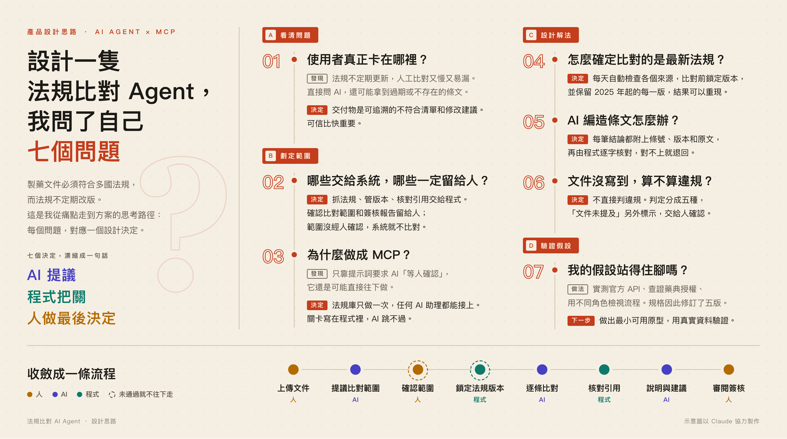
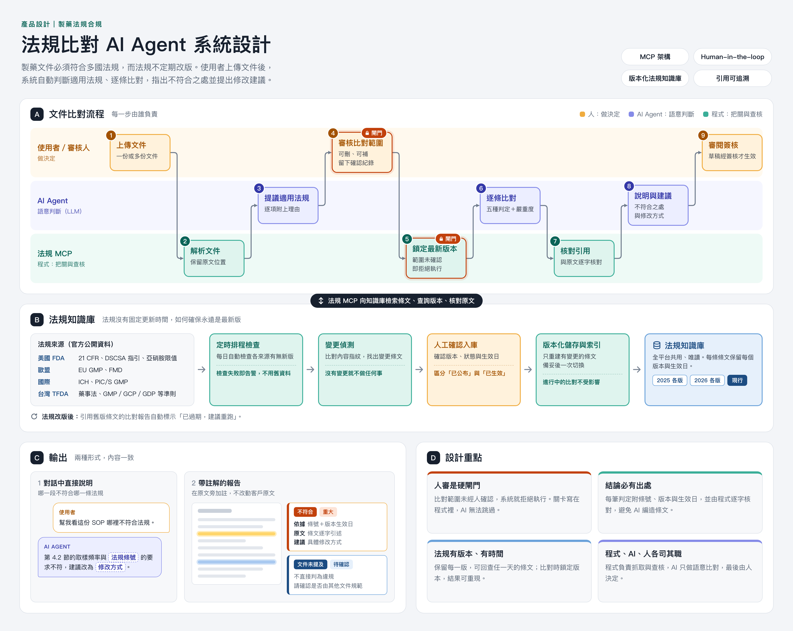

繁體中文 | [English](README.en.md)

# pharma-regulatory：法規查詢 MCP

讓 AI 助理查得到**官方、最新、帶出處**的製藥法規，不靠記憶回答。

<sub>v0.1 原型 · Python 3.10+ · MCP（Model Context Protocol）</sub>



---

## 為什麼做這個

製藥文件送出前，要確認符合各國最新法規。這件事有三個痛點：

1. **法規不定期改版。** 沒有固定的更新時間，很難確定手上那份是不是最新的。
2. **人工逐條比對又慢又容易漏。** 一份文件常常要對照好幾國的法規。
3. **直接問 AI，可能拿到過期或根本不存在的條文。** 模型的記憶停在訓練當時，而且會把條號說得很像真的。

完整的解法是一隻「法規比對 Agent」（見上圖與下方的系統設計圖）。**v0.1 先解決最底層的一段：讓 AI 查得到、有版本、有出處。**

- **查得到**：條文由固定程式向官方 API 取得，不是模型背出來的。
- **有版本**：每個抓到的版本都留在本機，只新增、不覆蓋；美國法規可以指定日期回查當時的條文。
- **有出處**：每一筆回傳都帶條號、版本日期、來源網址、擷取時間。

---

## 它能做什麼

接上之後，Claude 會多出四個工具：

| 工具 | 做什麼 | 可以這樣問 Claude |
|------|--------|------------------|
| `list_sources` | 列出已收錄的法規，以及各自最後檢查、最後變更的時間 | 「法規查詢工具收了哪些法規？上次確認是什麼時候？」 |
| `check_updates` | 即時向官方來源查：某部法規自某日起有哪些條文改版 | 「21 CFR Part 211 從 2025 年到現在改了哪些條？」 |
| `get_clause` | 取得某一條的原文，可指定日期回查當時的版本 | 「21 CFR 211.52 在 2025 年 4 月 1 日的條文是什麼？和現在差在哪？」 |
| `search_clauses` | 用關鍵字找出可能相關的條文 | 「藥物優良製造準則有哪些條文提到確效？」 |

<details>
<summary>參數與回傳狀態一覽</summary>

**參數**

| 工具 | 參數 | 說明 |
|------|------|------|
| `check_updates` | `source_id` | 法源代號：`us-21cfr`、`tw-pharmaceutical-affairs-act`、`tw-drug-gmp-regulations` |
| | `since` | 起始日期 `YYYY-MM-DD` |
| | `scope`（選填） | 21 CFR 可填 Part 編號（如 `211`）縮小範圍 |
| | `max_items`（選填） | 最多列出幾筆，預設 50 |
| `get_clause` | `source_id` | 同上 |
| | `clause_id` | 條號。21 CFR 寫 `211.22`；台灣法規寫 `57` 或 `6-1`（第 6 條之 1） |
| | `as_of`（選填） | `YYYY-MM-DD`，回查這一天當時有效的版本；不填就是最新版 |
| `search_clauses` | `query` | 關鍵字。21 CFR 用英文；台灣法規用中文，多個詞以空白分隔 |
| | `source_id`（選填） | 只搜尋某個法源；不填就全部搜尋 |
| | `scope`（選填） | 21 CFR 可填 Part 編號 |
| | `limit`（選填） | 每個法源最多回傳幾筆，預設 10 |

**回傳的 `status`**

| status | 意思 | 有條文內容嗎 |
|--------|------|-------------|
| `ok` | 向來源確認過，內容可用 | 有 |
| `not_found` | 來源明確說沒有這條（或沒有那個日期的版本） | **沒有** |
| `unverified` | 連不上來源；附的是本機舊資料，無法確認是否最新 | 有，附警告 |
| `outdated` | 來源已有新版，但還拿不到新版條文；附的是舊版 | 有，附警告 |
| `source_unavailable` | 連不上來源，本機也沒有資料 | **沒有** |
| `invalid_input` | 參數寫法有問題（例如日期格式不對） | 沒有 |
| `partial` | （僅搜尋）部分法源成功、部分失敗 | 視情況 |

</details>

---

## 實際查詢範例

以下都是 2026-11-24 透過 MCP 實際呼叫得到的回傳，沒有改寫。

### 範例 1｜取得現行條文

`get_clause(source_id="us-21cfr", clause_id="211.52")`

```json
{
  "status": "ok",
  "source_id": "us-21cfr",
  "clause_id": "211.52",
  "citation": "21 CFR 211.52",
  "heading": "§ 211.52 Washing and toilet facilities.",
  "text": "Adequate washing facilities shall be provided, including hot and cold water, soap or detergent, air driers or single-service towels, and clean toilet facilities easily accesible to working areas.",
  "provenance": {
    "version_date": "2025-05-27",
    "as_of": "2026-11-20",
    "source_url": "https://www.ecfr.gov/api/versioner/v1/full/2026-11-20/title-21.xml?part=211&section=211.52",
    "web_url": "https://www.ecfr.gov/on/2026-11-20/title-21/section-211.52",
    "retrieved_at": "2026-11-24T16:05:43+08:00",
    "checksum": "sha256:bf2ea8eb9cf542d1180bab219ca4d165256fb91b56982213438277e430953022"
  },
  "freshness": {
    "confirmed": true,
    "checked_at": "2026-11-24T16:05:43+08:00",
    "note": "已向 eCFR 確認，這是 2026-11-20 當時有效的版本（eCFR 資料更新至 2026-11-20）。"
  },
  "warnings": []
}
```

| 欄位 | 意思 |
|------|------|
| `text` | 條文原文，逐字照錄 |
| `provenance.version_date` | 這個版本的日期 |
| `provenance.as_of` | 這次查的是「哪一天當時有效」的版本 |
| `provenance.source_url` | 程式實際抓資料的網址，任何人都能重抓驗證 |
| `provenance.web_url` | 人可以直接打開核對的官方網頁 |
| `provenance.retrieved_at` | 這段原文是何時抓的 |
| `provenance.checksum` | 內容指紋：文字改一個字，指紋就不同 |
| `freshness` | 有沒有向來源確認過這是最新版 |

### 範例 2｜用 `as_of` 回查舊版

同一條，加上 `as_of="2025-04-01"`（節錄 `text` 與 `provenance`，其餘欄位結構同範例 1）：

```json
{
  "text": "Adequate washing facilities shall be provided, including hot and cold water, soap or detergent, air driers or single-service towels, and clean toilet facilities easily accessible to working areas.",
  "provenance": {
    "version_date": "2016-11-29",
    "as_of": "2025-04-01",
    "source_url": "https://www.ecfr.gov/api/versioner/v1/full/2025-04-01/title-21.xml?part=211&section=211.52",
    "web_url": "https://www.ecfr.gov/on/2025-04-01/title-21/section-211.52",
    "retrieved_at": "2026-11-24T16:05:48+08:00",
    "checksum": "sha256:4c56cf333802f22e73cbb7697ae1ca08e08a91a0b296455959b9c083d45821ba"
  }
}
```

兩個版本只差一個字：2016-11-29 版寫 `accessible`，2025-05-27 版寫 `accesible`（少一個 s）。版本日期和內容指紋都不同——程式照錄來源的原文，不會自作主張「修正」拼字。

### 範例 3｜台灣法規，連同生效註記

`get_clause(source_id="tw-pharmaceutical-affairs-act", clause_id="6-1")`

```json
{
  "status": "ok",
  "source_id": "tw-pharmaceutical-affairs-act",
  "clause_id": "6-1",
  "citation": "藥事法 第 6-1 條",
  "heading": "第 一 章 總則",
  "text": "經中央衛生主管機關公告類別之藥品，其販賣業者或製造業者，應依其產業模式建立藥品來源及流向之追溯或追蹤系統。\n中央衛生主管機關應建立前項追溯或追蹤申報系統；前項業者應以電子方式申報之，其電子申報方式，由中央衛生主管機關定之。\n前項追溯或追蹤系統之建立、應記錄之事項、查核及其他應遵行事項之辦法，由中央衛生主管機關定之。",
  "provenance": {
    "version_date": "2026-03-04",
    "as_of": "2026-11-24",
    "source_url": "https://law.moj.gov.tw/api/Ch/Law/JSON",
    "web_url": "https://law.moj.gov.tw/LawClass/LawSingle.aspx?pcode=L0030001&flno=6-1",
    "retrieved_at": "2026-11-24T16:05:52+08:00",
    "checksum": "sha256:e652a7626651f32d23ea5a2eb1c34bba86b92b1b4aae5687de3c79508228af8d"
  },
  "freshness": {
    "confirmed": true,
    "checked_at": "2026-11-24T16:05:52+08:00",
    "note": "已向全國法規資料庫確認：官網修正日期 2026-03-04，這是目前適用的版本（版本日期 2026-03-04）。"
  },
  "warnings": [
    "這部法規有「生效內容」註記（見 law_effective_note）：部分條文的施行日期另定，引用前請確認這一條是否已經生效。"
  ],
  "law_effective_note": "一百十五年三月四日修正公布之第 27-2、27-3、96-1 條條文，依第 106 條規定：施行日期由行政院定之。"
}
```

`law_effective_note` 是官方資料裡的原文註記：有些條文已經公布、但還沒生效。這種資訊會原封不動帶出來，不會被略過。

---

## 目前收錄的法規

| 法源 | 官方來源 | 能否回查歷史版本 |
|------|---------|-----------------|
| 美國聯邦法規 21 CFR（Title 21: Food and Drugs） | [eCFR 官方 API](https://www.ecfr.gov/developers/documentation/api/v1) | **可以。** 指定任一天，取得當時有效的條文 |
| 台灣《藥事法》 | [全國法規資料庫 OpenAPI](https://law.moj.gov.tw/api/swagger/docs/v1) | **官方 API 只有現行版。** 本工具從第一次抓取起保留每個版本，之前的版本查不到 |
| 台灣《藥物優良製造準則》 | 同上 | 同上 |

幾點老實說明：

- **台灣法規回查更早的日期會得到 `not_found`**，不會拿現行版充數。
- **台灣的官方開放資料會比官網慢幾天。** 程式會對照官網上的「修正日期」；若官網已改版而開放資料還沒跟上，回傳會標示 `outdated`，說明手上的條文可能不是最新。
- **21 CFR 以整條（section）為單位**，還不支援附錄與單獨取某一款；條文裡的表格會轉成純文字。
- **eCFR 是持續更新的線上版本，不是 CFR 的法定正式版。**
- **台灣法規目前只收中文版。**
- 全部是政府公開資料，不需要任何帳號或金鑰。

---

## 快速開始

需要先安裝 [uv](https://docs.astral.sh/uv/)（Python 的套件與版本管理工具）。不必自己安裝 Python，uv 會準備。

**1. 安裝**

```bash
git clone https://github.com/dorislai/pharma-regulatory.git
cd pharma-regulatory
uv sync
```

**2. 確認能跑**

```bash
uv run python scripts/smoke_test.py
```

這會實際連上兩個官方來源、把四個工具都呼叫一遍，約 30–60 秒。平常不需要自己啟動 server——接到 Claude 之後，Claude 會在需要時自動啟動它（想手動啟動可以執行 `uv run pharma-reg-mcp`）。

**3. 接到 Claude**

把 `/path/to/pharma-regulatory` 換成專案資料夾的完整路徑（在專案資料夾裡執行 `pwd` 可以看到）：

```bash
claude mcp add --scope user pharma-reg -- uv run --directory /path/to/pharma-regulatory pharma-reg-mcp
```

<details>
<summary>Claude Desktop 的設定方式、如何移除</summary>

在 `claude_desktop_config.json` 的 `mcpServers` 裡加入（`uv` 建議寫完整路徑，可用 `which uv` 查），存檔後重新啟動 Claude Desktop：

```json
{
  "mcpServers": {
    "pharma-reg": {
      "command": "/path/to/uv",
      "args": ["run", "--directory", "/path/to/pharma-regulatory", "pharma-reg-mcp"]
    }
  }
}
```

從 Claude Code 移除：

```bash
claude mcp remove --scope user pharma-reg
```

</details>

**4. 問第一個問題**

開一個新對話，試試：

> 21 CFR 211.22 的原文是什麼？請附出處。

---

## 運作方式



**這張圖畫的是完整設計；v0.1 只實作其中「法規查詢」這一塊**——也就是圖中「法規 MCP」負責的查條文、查版本，以及「法規知識庫」的版本保存。文件上傳、比對、人工審核和報告輸出都還沒做。

v0.1 的運作很單純：

1. Claude 啟動這支程式，問它「你有哪些工具」，程式回覆四個工具的名稱、說明和參數。兩邊用標準輸入／輸出互傳訊息，程式就跑在你自己的電腦上，不必架網站。
2. 你問法規問題時，Claude 讀工具說明，自己判斷要呼叫哪個工具、帶什麼參數。
3. 程式用固定規則向官方 API 取資料，存進本機的 SQLite，把原文和出處傳回去。
4. Claude 根據拿到的原文回答，並附上條號、版本日期和網址。

AI 只決定「要不要查、查什麼」；「怎麼查、回什麼」全是固定程式，所以結果可以重現、可以查證。

---

## 設計原則

- **抓法規用固定程式，不用 LLM。** 解析 XML、JSON、換算日期都是寫死的規則，程式碼裡沒有呼叫任何語言模型。
- **每筆回傳都帶出處。** 條號、版本日期、來源網址、擷取時間，外加一個內容指紋。
- **查不到就說查不到。** 此時回傳裡沒有任何條文內容，並明確提醒 AI 不要補答。實際的回傳訊息長這樣：
  > 查不到：2026-11-20 當時的 21 CFR 沒有 211.9999 這一條（No matching content found.）。請如實告知使用者，不要用模型自己的記憶補上條文內容。
- **無法確認最新就明講。** 連不上來源時，就算拿本機存過的舊資料出來，也會標示 `unverified` 並附警告；本機也沒有資料時，直接回報無法提供。「連不上」不會被當成「沒有改版」。

另外，本機的版本紀錄**只能新增、不能修改或刪除**。這不是靠程式自律，而是資料庫本身設了鎖，任何修改或刪除指令都會被拒絕。

---

## 專案結構

```
pharma-regulatory/
├── src/pharma_reg_mcp/
│   ├── server.py        MCP 外殼：把四個功能登記成 Claude 看得懂的工具
│   ├── service.py       四個工具的核心邏輯，「誠實回報」的規則都在這裡
│   ├── store.py         本機 SQLite：檢查紀錄＋條文版本（只能新增）
│   ├── registry.py      已收錄的法源清單（要加法規從這裡加）
│   ├── http.py          對外連線：分清楚「連不上」和「來源說沒有」
│   ├── config.py        設定：資料存哪裡、最多等幾秒
│   └── sources/
│       ├── ecfr.py      美國 eCFR 的轉接頭（解析條文、版本清單、搜尋結果）
│       └── twlaw.py     台灣全國法規資料庫的轉接頭（解析整包資料、官網修正日期）
├── tests/               單元測試（不連網路）
├── scripts/
│   └── smoke_test.py    端到端冒煙測試（透過 MCP 連真實來源）
├── docs/                設計圖與一次冒煙測試的完整輸出
├── LICENSE              MIT 授權條款
└── pyproject.toml       專案設定與相依套件
```

資料預設存在 `~/.pharma-reg-mcp/regulations.db`（單一個 SQLite 檔；可用環境變數 `PHARMA_REG_MCP_HOME` 改位置）。裡面有兩張表：`checks` 記每一次檢查，`clause_versions` 記每一個抓到的條文版本。想親眼看看：

```bash
sqlite3 ~/.pharma-reg-mcp/regulations.db "SELECT citation, version_date, fetched_at FROM clause_versions LIMIT 10;"
```

---

## 測試

```bash
uv run pytest
```

**單元測試**（91 個，不連網路）：用一個假的官方網站，驗證各種情況下的行為——正常查詢、查不到、斷線、官方開放資料落後官網、法規改版後新舊版本並存、資料庫拒絕修改與刪除。

```bash
uv run python scripts/smoke_test.py
```

**端到端冒煙測試**（連真實來源）：像 Claude 一樣透過 MCP 啟動 server，實際呼叫四個工具，並打開資料庫確認紀錄有寫入。一次實際執行的完整輸出放在 [docs/smoke-test-output.txt](docs/smoke-test-output.txt)。

---

## 後續規劃

以下全部是**規劃中**，尚未實作：

| 項目 | 內容 | 狀態 |
|------|------|------|
| 每日自動檢查 | 排程每天檢查各來源是否改版（v0.1 是被問到才查） | 規劃中 |
| 更多法源 | 台灣其他藥事法規、歐盟 EU GMP、PIC/S、ICH 等，依各來源的授權條件逐一確認；補齊台灣法規的歷史版本 | 規劃中 |
| 文件上傳與範圍確認閘門 | 上傳文件後由 AI 提議適用法規，必須經人確認範圍才能往下執行；關卡寫在程式裡 | 規劃中 |
| 逐條比對與引用核對 | 鎖定法規版本後逐條比對，分五種判定（「不符合」與「文件未提及」分開）；AI 引用的條文由程式和原文逐字核對 | 規劃中 |
| 註解報告 | 以註解的形式標在原文旁，不改動原始文件 | 規劃中 |

---

## 關於這個專案

由 [Doris Lai](https://github.com/dorislai) 設計。這是一個產品設計作品的實作原型：需求定義、流程設計與驗收由作者負責，程式以 AI 協作開發。

---

## 聲明

- 本專案僅供示範與學習，不是法律或合規意見。
- 法規內容以官方來源為準：美國 [eCFR](https://www.ecfr.gov/)、台灣[全國法規資料庫](https://law.moj.gov.tw/)。
- 本專案不是任何主管機關的官方工具。

---

## 授權

程式碼以 [MIT 授權](LICENSE)釋出。

法規內容來自各官方來源，其著作權與使用條款依各來源規定，不在本授權範圍內。
